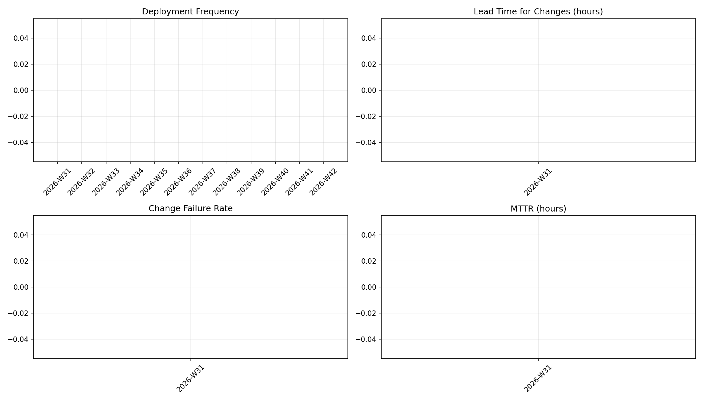

# 프로젝트 제안서 — Stock Snap

## 1. 프로젝트명
**Stock Snap** (`stock-snap`): 공시 AI 분석으로 종목을 추천하고, 추천 성과를 매일 자동 검증하는 주식 분석 사이트

## 2. 문제 정의
- 개인 투자자는 시세 차트는 쉽게 보지만, **기업 공시**처럼 주가에 영향을 주는 정보는 양이 많고 읽기 어려워 놓치기 쉽다.
- 시중의 "종목 추천"은 근거가 불투명하고, **추천이 실제로 맞았는지 사후 검증 결과를 공개하지 않는다.**
- **해결:** 시세 지표와 공시 감성 분석을 결합해 근거가 보이는 추천을 만들고, GitHub Actions로 **추천 성과를 매일 자동 채점해 공개**한다. 서버 없이 GitHub만으로 운영한다.

## 3. 핵심 기능
1. **시세 수집 및 기술적 분석**
   Actions `schedule`이 장 마감 후 시세를 수집해 **날짜별 Parquet 파일**(`data/prices/date=YYYY-MM-DD.parquet`)로 커밋한다. 누적 데이터는 **DuckDB**로 조회해 이동평균(5/20/60일), RSI, 거래량 변화를 계산하고, 대시보드용 요약은 경량 JSON으로 내보내 차트로 보여준다.

2. **공시 AI 감성 분석 기반 종목 추천** ⭐
   - OpenDART API로 관심 종목의 당일 공시를 수집한다.
   - 오픈소스 한국어 금융 감성 모델 **KR-FinBert-SC**로 공시 제목을 긍정, 중립, 부정으로 분류한다.
   - 기술 지표 점수와 공시 감성 점수를 합산해 상위 종목을 추천하고, 종목마다 **추천 근거**(어떤 지표, 어떤 공시)를 함께 표시한다.

3. **추천 성적표 자동 검증**
   - 과거 추천 종목의 이후 수익률을 매일 자동 계산해 벤치마크(KOSPI)와 비교한다.
   - 결과를 GitHub Pages에 공개하고, 주간 성적 요약은 Issue로 자동 게시한다.

> 본 사이트는 학습용 프로젝트이며 투자 권유가 아님을 명시한다.

## 4. 기술 스택
| 구분 | 기술 |
|---|---|
| 수집/분석 | Python, pandas, **DuckDB** |
| 저장 | **Parquet**(날짜별 파티션, 원본) + JSON(대시보드용 요약) |
| 데이터 소스 | 공공데이터포털 주식시세정보 API, **OpenDART API**(전자공시) |
| AI 모델 | **snunlp/KR-FinBert-SC** (Hugging Face Transformers) |
| 프론트 | HTML/JS, Chart.js |
| 자동화/배포 | GitHub Actions (schedule, cache, CI), GitHub Pages |
| 협업/관리 | Issues, PR 템플릿, Projects, Releases, Dependabot |

## 5. 16주 마일스톤
| 주차 | 내용 |
|---|---|
| 1 | 개발 환경 설정(SSH, 테스트 저장소), 제안서 작성 |
| 2–3 | 저장소 구성(README, LICENSE), Issue/PR 템플릿, Projects 칸반 |
| 4–5 | 시세 API, OpenDART 키 발급, 수집 스크립트 및 Parquet 저장 스키마 설계 |
| 6 | CI 워크플로 구축(PR마다 테스트) |
| 7 | 수집을 `schedule` 워크플로로 자동화하고 Secrets 적용 |
| 8 | **중간 점검, v0.1 릴리스**(수집 및 차트) |
| 9 | DuckDB 기반 기술 지표 계산 모듈, 대시보드용 JSON 내보내기 |
| 10–11 | KR-FinBert-SC 공시 감성 분석 적용, Actions 모델 캐싱 |
| 12 | 추천 점수 산정 및 추천 근거 표시 |
| 13 | 추천 성적표(수익률, 벤치마크 비교) 자동 계산 |
| 14 | Pages 자동 배포, 주간 성적 Issue 자동 게시 |
| 15 | Dependabot, 브랜치 보호 규칙 적용, 문서화 |
| 16 | **최종 발표, v1.0 릴리스** |

## 6. DORA 메트릭

### 지표 정의
| 지표 | 정의 |
|---|---|
| Deployment Frequency | `.github/workflows/deploy.yml` 중 `event == "push"` 이고 `conclusion == "success"` 인 배포 run의 ISO 주차별 개수 |
| Lead Time for Changes | main에 머지된 PR의 첫 커밋 author date부터, `head_sha == merge_commit_sha` 인 성공 배포 run `updated_at`까지의 시간(주차별 중앙값, 시간 단위) |
| Change Failure Rate | 해당 주차에 생성된 `label=incident` 이슈 수 / 해당 주차 성공 배포 수(배포 0이면 `null`) |
| MTTR | 해당 주차에 닫힌 `label=incident` 이슈의 `(closed_at - created_at)` 평균(시간 단위, 없으면 `null`) |

- 대시보드: https://proteinj.github.io/stock-snap/dora.html
- 수동 실행: GitHub Actions에서 `dora` 워크플로를 `workflow_dispatch`로 실행

## 7. 라벨 규칙

모든 이슈에는 아래 라벨을 각각 정확히 1개씩 붙입니다.

| 라벨 그룹 | 필수 개수 | 용도 | 예시 |
|---|---:|---|---|
| 유형 (`bug` / `enhancement` / `documentation` / `incident`) | 1개 | 이슈 성격 구분 | `bug` |
| 우선순위 (`priority:p1` ~ `priority:p3`) | 1개 | 처리 긴급도 구분 | `priority:p2` |
| 영역 (`area:*`) | 1개 | 영향 범위 구분 | `area:analysis` |

---

- 사이트: https://proteinj.github.io/stock-snap/
- 제안서 원본: [docs/PROPOSAL.md](docs/PROPOSAL.md)
- 라이선스: MIT
